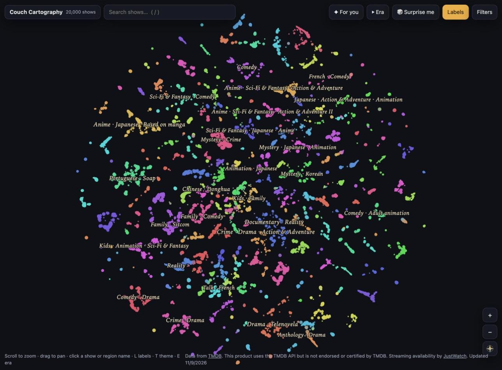

# Couch Cartography

An interactive 2-D map of about 20,000 TV shows, with similar shows placed near each other.

**[Open the live map →](https://harrisun-r.github.io/couch-cartography/)**



## Why I built it

Picking what to watch next usually means scrolling one service's rows, which only show what that service wants you to see. I wanted to see the whole landscape of TV at once: where a show sits, what's around it, and what I've never explored. I built it over a weekend as a hands-on exercise in turning embeddings and clustering into a product people can actually use.

## Product decisions

- **Recommendations that respect mixed taste.** "For you" finds a few separate taste centres (a small weighted k-means over the shows you've watched and loved) instead of one average. Someone who loves fantasy and crime gets good fantasy and good crime, not lukewarm shows that sit halfway between them. Every pick says "because you watched …" so it can be trusted or ignored.
- **Private by design.** Watch history imports, marks and recommendations all run in the visitor's browser. Nothing is uploaded, there are no accounts, and there's no backend to secure.
- **A map that doesn't move under you.** Each week's layout starts from last week's positions and is rotated to line up with them, and regions keep stable numbers. Returning visitors find shows where they left them.
- **Zero running cost.** GitHub Pages hosts the site and a weekly GitHub Actions job rebuilds the data, so it stays current without servers or maintenance.
- **Only licensed data.** Where-to-watch comes through TMDB's official API, which carries JustWatch's data, with the attribution both require.
- **Tunable similarity.** "Similar" is a weighted mix of genres, keywords, networks, language, country and people (`BLOCKS` in `pipeline/build_vectors.py`), so the grouping can be adjusted without touching the model code.

## Features

- **Search** by title or original title; picking a result flies the map to that show.
- **Details** for each show: overview, cast, how long it takes to finish, and its 20 most similar shows.
- **Where to watch** in any country (India by default), plus a filter for "streaming on my services".
- **Time to finish** filter: a weekend, a few weeks, a season of life, or the long haul.
- **Shareable links:** the URL holds the view, filters and selected show.
- **Surprise me** picks a well-rated show from the part of the map you're looking at.
- **Watched and watchlist** marks are saved in your browser, plus ♥ "Loved it". Save and restore a backup as JSON.
- **Import watch history** from Trakt (JSON export), IMDb (ratings or watchlist CSV) or Netflix (viewing history CSV, including the full export with profiles). You review the matches before anything is added.
- **For you:** recommendations worked out in your browser from what you've watched and loved, each with "because you watched …". It finds a few separate tastes, so liking fantasy and crime doesn't average out to neither, and it respects your current filters.
- **Map coverage:** how many regions you've explored, where you've spent the most time, and the biggest regions you've never visited; unexplored regions fade on the map.
- **Filters and highlights:** genre, type, keyword (Any or All matching), language, country of origin, network, status, minimum rating, minimum votes, and a first-aired year slider.
- **Map display:** dot size by popularity or number of seasons, and a dark or light parchment theme (press T). Both are remembered in your browser.
- **Region guides:** click a region name on the map for a description, its best-known shows and its main genres, networks, countries and years, plus "Highlight region" and "Zoom to region".
- **Bridge:** pick two shows and get the chain of similar shows linking them, drawn as a line across the map.
- **Compare:** pick two shows to see how alike they are (0–99%), what they share (genres, keywords, creators, cast, network, country, era) and where they differ.
- **Era animation:** press play to watch the map grow year by year; shows new that year are ringed, and you can drag to any year.
- Bridges, comparisons and region guides are in the link too, so they can be shared.
- **Keys:** `/` search, `L` labels, `T` theme, `E` era, `S` surprise me, `F` filters, `Esc` close or cancel.

Everything is free: GitHub Pages hosts the site, and a weekly GitHub Actions job rebuilds the data from TMDB.

```
pipeline/fetch.py          TMDB  ->  cache/tmdb.sqlite        (resumable, incremental)
pipeline/build_vectors.py  cache ->  build/vectors.npz        (weighted feature blocks)
pipeline/build_map.py      build ->  site/data/               (UMAP layout, HDBSCAN clusters, similar shows)
                                       points.json            everything needed to draw and filter
                                       details/NN.json        loaded when a show is opened
                                       providers/<CC>.json    where to watch, loaded per country
                                       graph.bin              20 nearest neighbours per show (bridge)
                                       vectors.bin            50-number vector per show (compare, For you)
                                       ids.json               IMDb ids, for importing IMDb exports
pipeline/cluster_notes.json  hand-written region names and descriptions
site/index.html            one static page, HTML5 Canvas, no build step
.github/workflows/update-map.yml   runs all of the above every Monday and deploys to Pages
```

## One-time GitHub setup

1. Create a **public** repo and push this folder to it. Public repos get unlimited Actions minutes.
2. Get a free TMDB API key at <https://www.themoviedb.org/settings/api>. Either the v3 key or the v4 read access token works.
3. Add the key as a secret: **Settings → Secrets and variables → Actions → New repository secret**, named `TMDB_API_KEY`.
4. Turn on Pages: **Settings → Pages → Source: GitHub Actions**.
5. Start the first build: **Actions → Update map → Run workflow**. Each run fetches every show, which takes about 15–30 minutes.

Your site will be live at `https://<user>.github.io/<repo>/`.

Optional: set a repository variable `TOP_N` (**Settings → Variables**) to change how many shows are mapped.

## How it stays up to date without you

- **Every Monday** the workflow downloads the cached database from a GitHub Release called `data-cache`. It refreshes popularity, fetches new popular shows and re-fetches every show older than six days. The full refresh keeps where-to-watch current, which TMDB's change feed doesn't reliably report. Then it rebuilds the map, uploads the database back to the release and deploys the site.
- **Stable layout:** the previous run's positions seed the new layout, and the result is rotated to line up with the old one. Shows stay roughly in place from week to week. To start the layout over, run the workflow manually with **fresh_layout** ticked.
- **Saved progress:** the cache is saved even when a run fails, so a broken run never loses fetched data.
- **Schedule kept alive:** each run commits `data_status.json`. GitHub disables schedules in public repos after 60 days with no activity, and these commits count as activity. If the schedule is ever disabled anyway, re-enable it from the Actions tab.

## Where to watch

Streaming data is JustWatch's, passed on by TMDB: each show's
`watch/providers` comes in the same TMDB request as its details, for every
country, and is refreshed every week through TMDB's official API.

In the detail panel:

- If the show is offered in the chosen country, its services are listed by
  stream, free, rent and buy, with the credit "Availability by JustWatch via TMDB".
- If it is offered elsewhere but not there, the panel says so and how many
  other countries have it.
- If nothing is known anywhere, it says "No where-to-watch data for this show
  yet" and links to a JustWatch search for the title. These are mostly older or
  regional shows that aren't streaming anywhere.

## Region names and descriptions

Regions are found automatically every week. Each gets a **number that stays
the same between runs**: a new region inherits the number of last week's region
it overlaps most, and numbers are never reused. The number is shown at the
bottom of each region guide ("Region #60").

Names come from the genres and keywords most typical of the region, and the
description is written from its stats, e.g. "Crime and drama shows from the
United States, South Korea and elsewhere, most first aired 1999–2025."

To write your own, edit `pipeline/cluster_notes.json`:

```json
{
  "60": { "name": "Crime, everywhere", "blurb": "Police procedurals and crime dramas from around the world." },
  "12": { "blurb": "Only the description is replaced; the automatic name stays." }
}
```

A `name` replaces the label on the map, a `blurb` replaces the description.
Commit the file and the next run uses it. If a region splits or changes a
lot, it gets a new number and your note simply stops showing.

## Importing watch history

Everything happens in the visitor's browser; files are never uploaded.

| Service | Where to get the file | What's used |
|---|---|---|
| Trakt | Settings → Data → Export, then unzip | `watched-shows.json`, `ratings-shows.json`, `watchlist-shows.json` (matched by TMDB id) |
| IMDb | Your ratings / Your watchlist → ⋯ → Export | TV series and miniseries rows (matched by IMDb id); films and single episodes are skipped |
| Netflix | Account → profile → Viewing activity → Download all, or the full "Get my info" export | `NetflixViewingHistory.csv` or `ViewingActivity.csv` (matched by title; pick the profile) |
| Other | Any CSV with a `title`, `tmdb_id` or `imdb_id` column | optional `year`, `rating`, `status` columns |

Netflix shows with only 1–2 episodes watched are treated as "sampled" and left
out unless you tick the box. Ratings of 8/10 or more count as loved; 4/10 or
less push similar shows down in For you.

## Run it locally

```bash
python3 -m venv .venv && source .venv/bin/activate
pip install -r requirements.txt
export TMDB_API_KEY=...            # your key
python pipeline/fetch.py --top-n 2000      # small trial first
python pipeline/build_vectors.py --top-n 2000
python pipeline/build_map.py
python -m http.server -d site 8000         # open http://localhost:8000
```

On an Intel Mac, `pip` may try to compile numba from source and fail. If so, run `pip install --only-binary :all: numba` first, then install the requirements again.

Marks, chosen services and country are stored in each visitor's browser (`localStorage`), so nothing personal ever reaches the site or GitHub.

To tune how shows group together, edit the `BLOCKS` weights at the top of `pipeline/build_vectors.py`.

## Credits

Data from [TMDB](https://www.themoviedb.org/). This product uses the TMDB API but is not endorsed or certified by TMDB. Streaming availability is provided by [JustWatch](https://www.justwatch.com/) through TMDB; the site must keep that credit. The pipeline design follows Mikey Guinness's [Movie Map](https://mikeyguinness.com/projects/movie-map/).

## License

The code is released under the [MIT License](LICENSE). The data the pipeline downloads belongs to TMDB and JustWatch and is not covered by this license; it is used under TMDB's API terms, which allow non-commercial use with attribution.
